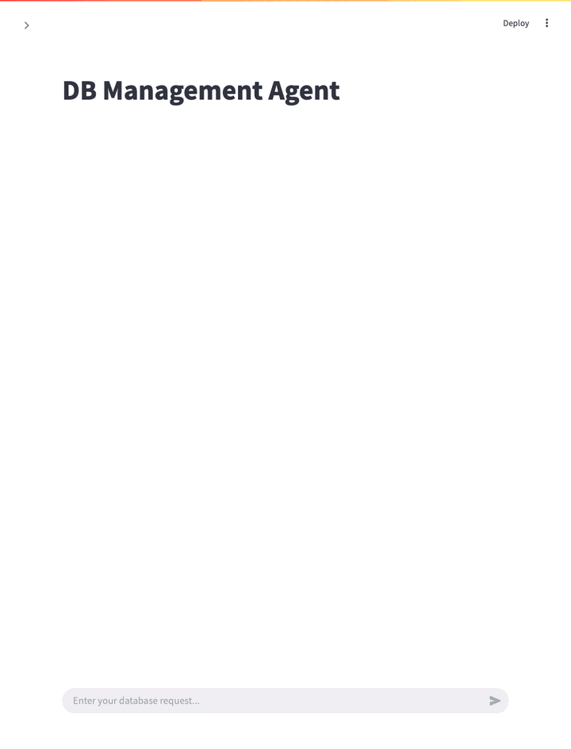
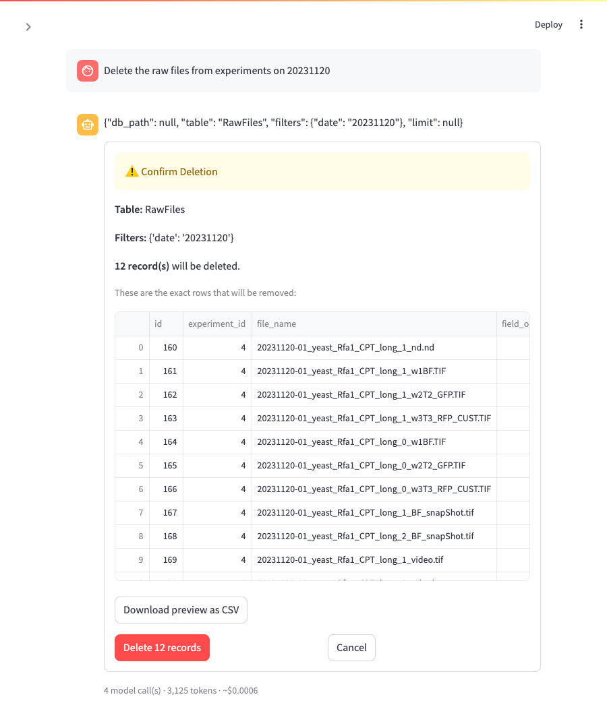

# Database Management Agent

An LLM-powered, multi-agent system that lets biologists search, insert and delete
records in a laboratory SQLite database in plain English, with no SQL.

It is built with Google's [Agent Development Kit (ADK)](https://google.github.io/adk-docs/)
and Gemini. The agents never write SQL: they choose between tested Python
functions, every deletion needs human approval of the exact rows, and every
action is logged.

<p align="center">
  
</p>

**Status:** Version 1, focused on correctness, safety and observability.
Contributors: Niusha Mirhakimi, Masoumeh Shafiei.

**The idea in one line: the LLM translates, the code decides.** Gemini turns a
request such as *"Remove the raw image files from the second replicate of the
November 15th, 2024 experiment"* into exact parameters
(`RawFiles`, `{date: 20241115, replicate: 2}`). Every decision that must not be
wrong (is the file valid, are there filters, did the user approve) is made in
Python, not in a prompt.

**Highlights**

- No generated SQL: agents fill validated parameters for tested query functions.
- Deletion is previewed row by row and needs approval; what you approve is exactly what is deleted.
- Inserts are gated in code: a file is inserted only if that exact file passed validation.
- A [64-case evaluation](#agent-evaluation-calls-gemini-about-004-per-full-run) on ADK's framework, with deterministic metrics:
  **no deletion has ever run without approval**.
- Every request is audit-logged with its Gemini tokens and estimated cost; optional Phoenix tracing.

**Contents:** [Why](#why) · [Architecture](#architecture) · [Getting started](#getting-started) ·
[Using it](#using-it) · [Testing and evaluation](#testing-and-evaluation) ·
[Observability](#observability) · [Project structure](#project-structure) ·
[Known limitations](#known-limitations)

---

## Why

Many biology labs keep experimental metadata (microscopy files, conditions,
strains, analysis results) in a relational database such as SQLite, but:

- most users do not know SQL,
- direct database access makes accidental data loss easy,
- validation, auditing and reproducibility are often missing or ad hoc.

This project puts an agent layer between the user and the database. It accepts
plain-English requests, routes each one to a specialist agent, runs only
predefined Python query builders, and logs every action.

---

## Architecture

```
User
 ├─ Web path:  Streamlit UI (ui/app.py)
 │               ↓ HTTP
 │             FastAPI backend (server.py)
 │               ↓ await
 └─ CLI path:  main.py
                ↓
              workflow.py  (submit_request · resume_with_confirmation)
                ↓
              ADK root_agent (Gemini 2.5 Flash)
                ↓ transfer_to_agent
        ┌───────┼──────────────────────┐
   query_agent  insert_supervisor_agent  delete_supervisor_agent      (Gemini 2.5 Flash-Lite)
        │        (validate → insert)      (extract filters → preview → confirm → delete)
        ↓              ↓                        ↓
              lab_data_manager (separate repository)
                        ↓
                  SQLite database
```

The CLI and the web UI call the same `workflow.py` functions, so the agents do
not know which front end is driving them.

### Design decisions

1. **No free-form SQL.** Agents call explicit, tested query-builder functions
   from the `lab_data_manager` package. This rules out hallucinated or unsafe
   SQL and keeps behaviour testable.
2. **The database layer is a separate repository**,
   [data-management-system-SQLite](https://github.com/masoomeshafiee/data-management-system-SQLite).
   It must be installed before this app (see [Getting started](#getting-started)).
3. **Deletion is two-step and confirmation-gated.** `preview_deletion` dry-runs
   the request, saves the exact rows to a CSV and stores the filters in session
   state. `execute_deletion` is registered with ADK's `require_confirmation=True`,
   which pauses the agent until the user approves. It then reads the filters
   back from the stored preview, never from a new model output, so what you
   approve is exactly what gets deleted.
4. **Insertion is gated in code too.** The validation tools record in session
   state which file was checked and whether it passed. `insert_csv_with_report`
   refuses (`status: blocked`) unless that exact file passed. The prompt used to
   be the only guard, and the evaluation caught the model inserting files that
   had just failed validation.
5. **Facts shown to the user come from the tools, not the model's wording.**
   `workflow.py` reads the deletion preview, the deleted count, the insert
   counts and the invalid rows directly from the tool results in ADK's events.
   When Gemini ends its turn with an empty reply, which it sometimes does after
   a tool call, the app shows the tool's result instead of nothing.

### Agents

| Agent | File | Role |
|---|---|---|
| Root | `agent/root_agent.py` | Routes each request to a specialist. Never touches the database. |
| Query | `agent/query_agent.py` | Search, count, trend and data-quality questions, through read-only tools. |
| Delete supervisor | `agent/delete_supervisor_agent.py` | `SequentialAgent`: filter agent → delete agent. |
| Filter | `agent/filter_agent.py` | Turns a request into a structured `{table, filters, limit}` (`DeletionSchema`). |
| Delete | `agent/delete_agent.py` | `preview_deletion`, then `execute_deletion` after approval. |
| Insert supervisor | `agent/insert_supervisor_agent.py` | `SequentialAgent`: validation agent → insert agent. |
| Data validation | `agent/data_validation_agent.py` | Validates a CSV and writes every invalid row, with its reasons, to a file. |
| Insert | `agent/insert_agent.py` | Inserts the CSV and reports inserted and skipped rows. |

`agent/pydantic_models.py` holds the shared filter schema (`LabFilters`,
`StrictLabFilters`, `DeletionSchema`), `agent/utils.py` the deterministic helpers
(table-name resolution, deletion state, retry on rate limits) and
`agent/config.py` loads `.env` and the shared retry settings.

---

## Getting started

### Prerequisites

- Python 3.10 or newer (developed on 3.14)
- git
- A Google AI Studio API key: [aistudio.google.com](https://aistudio.google.com) → *Get API key*

### 1. Install the database library first

`lab_data_manager` is **not on PyPI**. Install it from its own repository,
from the `agent` branch, before installing this app. Clone both repositories
side by side and use a single virtual environment:

```bash
mkdir lab-agent && cd lab-agent
python -m venv .venv
source .venv/bin/activate            # Windows: .venv\Scripts\activate

git clone https://github.com/masoomeshafiee/data-management-system-SQLite.git
cd data-management-system-SQLite
git checkout agent
pip install -e .                     # editable: library changes apply without reinstalling
cd ..
```

> **Until [PR #73](https://github.com/masoomeshafiee/data-management-system-SQLite/pull/73)
> is merged**, the `agent` branch is missing two fixes this app relies on: the
> experiment-query column names, and skipping blank rows that Excel adds at the
> end of a CSV. Without the second one, valid files are rejected. Pull them in
> with:
>
> ```bash
> cd data-management-system-SQLite
> git pull https://github.com/mirhnius/data-management-system-SQLite.git fix/experiment-query-column-names
> cd ..
> ```

### 2. Install this app

```bash
git clone https://github.com/masoomeshafiee/DB_management_agent.git
cd DB_management_agent
pip install -r requirements.txt
python -c "import lab_data_manager; print('lab_data_manager OK')"
```

### 3. Configure

```bash
cp .env.example .env
# edit .env and set GOOGLE_API_KEY=<your key>
```

### 4. Sample data

`data/sample_data.db` is included: 63 yeast Rfa1 experiments with about 5,700 raw
files, 800 masks and 500 tracking files. The agents use it by default. Deletions
are real, so keep a copy:

```bash
cp data/sample_data.db data/sample_data.backup.db     # restore later with the reverse copy
```

---

## Using it

```bash
# CLI
python main.py

# Web: start the backend, then the UI in a second terminal
uvicorn server:app --reload          # http://localhost:8000
streamlit run ui/app.py              # http://localhost:8501
```

In the UI, enter a session name in the sidebar (sessions are saved and can be
resumed), then type requests in the chat. To insert data, upload a CSV in the
sidebar instead of typing its path.

### Search

```
Find all experiments with organism yeast and protein Rfa1 that are untreated and invalid.
```
→ the query agent calls `search_experiments` with those four filters and finds
the 11 matching experiments.

Requests don't need the database's vocabulary:

| You type | The agent calls |
|---|---|
| How many experiments do we have for each **treatment**? | `count_experiments_by_group(group_by=["condition"])` |
| What experiments did we run on **November 15th, 2024**? | `search_experiments_by_date_range("20241115", "20241115")` |

### Insert a CSV

```
Insert the data from the CSV file located at /path/to/metadata.csv into the database at data/sample_data.db
```
1. Every row is validated first: required fields, date format, allowed organisms,
   capture types, units and so on.
2. **If any row is invalid, nothing is inserted**, and this is enforced in code,
   not by the prompt. The UI shows a table of the invalid rows, with the Excel
   row number and the reason for each, and a download button.
3. If the file is valid it is inserted. Rows already in the database are
   skipped as duplicates and listed with the reason.

### Delete (human in the loop)

```
Remove the raw image files from the second replicate of the November 15th, 2024 experiment.
```
1. The filter agent extracts `{table: RawFiles, filters: {date: 20241115, replicate: 2}}`
   and `preview_deletion` runs a dry run.
2. The UI shows the table, the filters, the number of records and **the exact
   rows that will be deleted**, with **Delete N records** and **Cancel** buttons.
3. Only after **Delete** is anything removed. The UI then shows the deleted
   count reported by the tool itself.

<p align="center">
  
</p>

Requests without usable filters, such as `Delete everything`, are blocked.

After each answer the CLI prints what the request cost, for example:
```
[usage] 3 model call(s), 8,647 in / 42 out / 65 thinking tokens, ~$0.0012
```

---

## Testing and evaluation

### Tests: no API key needed, a few seconds

```bash
pytest test/unit test/integration -v
```

- **Unit tests** cover the deterministic code: filter schemas, the deletion
  safety layer, workflow and event parsing, token counting and the evaluation
  metrics.
- **Integration tests** run against a temporary copy of a real SQLite database
  and the FastAPI routes, with the LLM faked.

See [test/README.md](test/README.md).

### Agent evaluation: calls Gemini, about $0.04 per full run

Unit tests fake the model, so they cannot show how Gemini behaves. The
`evaluation/` module runs **64 realistic requests** through the real agents,
using ADK's evaluation framework, on a **checksummed copy** of the database.
There are five suites, one per agent layer, so a failure points to the agent
responsible:

| Suite | Cases | Checks |
|---|---|---|
| routing | 21 | the root agent picks the right specialist |
| filter_extraction | 15 | plain English → the right table, filters and limit |
| deletion | 13 | the whole delete pipeline ends safely; it is never approved |
| search | 9 | the right query tool, and the right facts in the answer |
| insertion | 6 | validate first, insert only if the file passed |

Scoring uses five custom metrics written in plain Python, not an LLM judge, so
scoring is free and gives the same result every time. Filters are normalised
with the app's own `StrictLabFilters`, so equivalent values compare as equal.

```bash
python -m evaluation                                           # all suites → evaluation/results/latest/report.md
python -m evaluation --suite deletion --runs 3                 # one suite, each case three times
python -m evaluation --suite deletion --case delete-everything # a single case
python -m evaluation --export                                  # write the cases as ADK .evalset.json files
RUN_AGENT_EVAL=1 pytest test/agent_eval -v                     # the suites as pass/fail tests
```

**Latest results** ([full report](evaluation/results/latest/report.md), one run per case):

| Suite | Metric | Result |
|---|---|---|
| routing | right specialist | 19/21 (90%) |
| filter_extraction | right table, filters and limit | 15/15 (100%) |
| deletion | right outcome | 10/13 (77%) |
| deletion | **deletions executed without approval** | **0** |
| search | right tool | 8/9 (89%) |
| search | answer contains the facts | 3/7 (43%) |
| insertion | right tools, no write after failed validation | 6/6 (100%) |

A full run makes about 130 Gemini calls for an estimated $0.03. Results vary
between runs because the model does; use `--runs 3` for steadier numbers. What
the failures mean is listed under [Known limitations](#known-limitations).

Insertion went from 3/6 to 6/6 after the insert gate moved into code. In the
three cases with invalid files the model still calls the insert tool, and the
tool refuses it, so nothing is written. The metric counts a write tool only if
it actually ran.

---

## Observability

- **Logs** (`observability/logging_config.py`), each file rotating at 5 MB:
  - `logs/audit.log`: one line per request, tool call, approval decision,
    response and token count. This is the audit trail.
  - `logs/app.log`: application logs.
  - `logs/adk.log`: ADK and Gemini framework logs.
  - `logs/error.log`: warnings and errors, including unhandled FastAPI exceptions.
- **Token usage and cost** (`observability/token_usage.py`): every answer in the
  UI shows its Gemini calls, tokens and estimated cost, and the sidebar shows a
  session total. The CLI prints a `[usage]` line and the evaluation report
  includes a cost table. Costs are estimated from list prices; the real bill is
  in Google AI Studio.
- **Tracing with Arize Phoenix** (optional): see every agent hand-off, Gemini
  call (prompt and response) and tool call (arguments and result) as a tree.

  ```bash
  uvx --python 3.12 --from arize-phoenix==20.26.0 phoenix serve   # UI at http://localhost:6006
  PHOENIX_TRACING=1 uvicorn server:app --reload                   # also works for main.py and python -m evaluation
  ```
  Traces contain prompts and database rows, so keep Phoenix local.

---

## Project structure

```
DB_management_agent/
├── agent/                     # the ADK agents and their tools (see Agents above)
├── workflow.py                # submit_request() / resume_with_confirmation(); reads results from ADK events
├── main.py                    # CLI
├── server.py                  # FastAPI backend: /session /chat /confirm /cancel
├── ui/app.py                  # Streamlit front end
├── observability/
│   ├── logging_config.py      # rotating log files
│   ├── token_usage.py         # tokens and estimated cost per request
│   └── tracing.py             # optional Arize Phoenix tracing
├── evaluation/                # agent evaluation on ADK's eval framework
│   ├── scenarios.py           # the 64 cases: request + expected behaviour
│   ├── metrics.py             # the custom ADK metrics
│   ├── sandbox.py             # runs on a checksummed copy of the database
│   ├── runner.py              # suites, rate-limit retries, token usage
│   ├── report.py              # report.md + results.json
│   ├── evalsets/              # the cases exported as ADK .evalset.json files
│   └── results/latest/        # the last run's report
├── test/
│   ├── unit/                  # no model calls, no real database
│   ├── integration/           # real SQLite copy and FastAPI, model faked
│   ├── agent_eval/            # evaluation suites as opt-in pass/fail tests
│   └── scenarios/             # hand-written scenarios and CSV files
├── demo/                      # demo CSVs, the demo steps, and a script that records them
├── docs/images/               # README GIF and screenshot
├── data/sample_data.db        # sample database
├── requirements.txt           # (lab_data_manager is installed separately, see Getting started)
├── .env.example
└── NEXT_STEPS.md              # planned work
```

---

## Known limitations

Found by the evaluation suite and manual testing. Deletion and insertion are
protected in code: every deletion shows a preview and needs explicit approval,
and in evaluation **no deletion has ever run without approval**. The items below
are what I'm fixing next.

### Requests that should be refused earlier

- Unknown table names can be mapped to a real table (e.g. `ImageStacks` →
  `RawFiles`), and an unknown field can be turned into a real one (`location lab1`
  → `condition: lab1`). These requests still stop at the preview and approval
  step, but they should be refused before it.

### Routing

- A question that mentions deleting ("How many records would be affected if I
  deleted …?") can be routed to the delete pipeline instead of search. It still
  needs approval before anything is removed.
- Off-topic questions ("What is a fluorescence microscope?") are sent to the
  query agent instead of being answered directly.

### User experience

- When Gemini returns an empty reply, the fallback shows the tool's raw result,
  which is correct but not a friendly sentence.
- "How many experiments are there?" can count a capped 20-row list instead of
  using a count tool.

### Scope

- Single-user (`default_user`), and CSV upload needs the UI and backend on the same machine.

---

## Technologies

Python · SQLite · Google ADK · Gemini 2.5 Flash / Flash-Lite · FastAPI · Streamlit · pytest · Arize Phoenix (optional)

## Contributors

- **Masoumeh Shafiei**
- **Niusha Mirhakimi**
